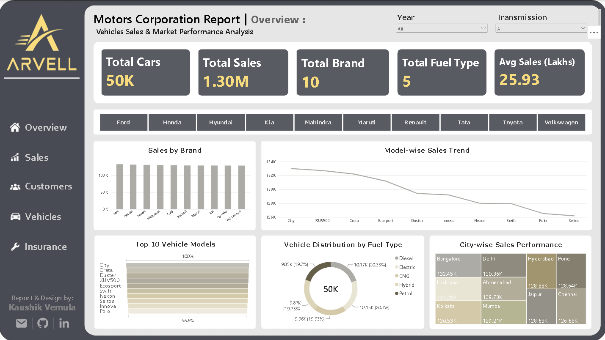

# 🚘 ARVELL – Motors Corporation Report

### Automobile Business Intelligence & Performance Analytics

> **Turning Automotive Data into Meaningful Business Insights.**

---

## 📌 About the Project

**ARVELL – Motors Corporation Report** is an end-to-end business analytics project based on a fictional automobile company. The project focuses on analysing automotive business data to understand sales performance, customer behaviour, vehicle distribution and insurance performance.

Using **Microsoft Excel, SQL and Power BI**, raw datasets are transformed into meaningful insights through data preparation, analysis and interactive visualisation.

The project demonstrates how data analytics can support business monitoring, performance evaluation and data-driven decision-making in the automobile industry.

## 🎯 Project Objectives

- Analyse overall automobile sales and business performance.
- Understand customer purchasing patterns and behaviour.
- Evaluate vehicle distribution across different categories.
- Examine insurance-related performance and trends.
- Build an interactive dashboard for business monitoring.
- Present key business information through clear visual reports.

## 🛠️ Tools & Technologies

| Tool               | Purpose                                                 |
| ------------------ | ------------------------------------------------------- |
| Microsoft Excel    | Data cleaning, preparation and initial analysis         |
| SQL                | Data querying, filtering and analysis                   |
| Microsoft Power BI | Data modelling, visualisation and dashboard development |

## 📊 Dashboard Overview

The Power BI report is organised into five analytical sections:

| Dashboard Page | Focus Area                                      |
| -------------- | ----------------------------------------------- |
| 🏠 Overview    | Overall business performance and key indicators |
| 💰 Sales       | Sales performance and trends                    |
| 👥 Customers   | Customer-related analysis                       |
| 🚗 Vehicles    | Vehicle distribution and performance            |
| 🛡️ Insurance  | Insurance-related analysis                      |

## 🖼️ Dashboard Preview



*Explore the dashboard screenshots in the `.images` folder.*

## 📁 Repository Structure

```text
01-ARVELL-Motors-Corporation-Report/
│
├── .images/              # Dashboard screenshots
│
├── dataset/              # Project datasets
│
├── ARVELL.pbix           # Power BI dashboard
│
├── Documentation.pdf     # Detailed project documentation
│
├── #script.SQL.md        # SQL analysis script
│
└── README.md             # Project overview
```

## 📖 Project Documentation

For a detailed explanation of the project, including its workflow, data preparation, analytical approach and dashboard development, refer to:

📄 [**View Project Documentation**](Documentation.pdf)

## 💡 Key Highlights

- End-to-end analytics workflow.
- Multiple datasets organised for business analysis.
- SQL-based data exploration and analysis.
- Interactive, multi-page Power BI reporting.
- Business-focused visualisation and performance monitoring.
- Structured project documentation.

## 👨‍💻 Author

**Kaushik Vemula**

Aspiring Data Analyst | Excel | SQL | Python | Power BI

- 💼 LinkedIn: [kaushik-vemula-xk7](https://www.linkedin.com/in/kaushik-vemula-xk7/)
- 🐙 GitHub: [k4ushik-vk7](https://github.com/k4ushik-vk7)

---

### 🚘 ARVELL – Motors Corporation Report

*From Raw Data to Business Insights.*
